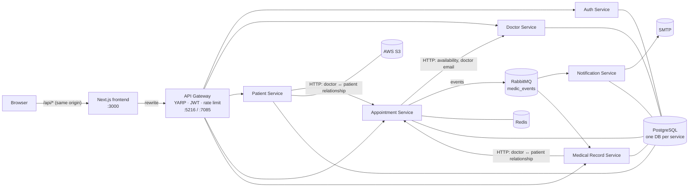

# Medical Appointment System

A medical appointment platform for **patients** and **doctors**, built as .NET 9 microservices with a Next.js 16 frontend.

- **Patients:** search doctors, book an appointment in a free slot, cancel it, edit their profile, read their medical history and consultation notes, and share medical documents.
- **Doctors:** manage their agenda and weekly hours, block time off, confirm, reschedule, complete and document appointments, keep each patient's medical history, issue documents (prescriptions, orders, certificates…) and see their care statistics.
- **Notifications:** emails for new, confirmed, cancelled and rescheduled appointments.

---

## Architecture



Every service follows Clean Architecture: `Domain` → `Application` (use cases, DTOs, interfaces) → `Infrastructure` (EF Core, RabbitMQ, Redis, S3, HTTP clients) → `API` (controllers).

### Services

| Service | HTTPS / HTTP port | Responsibility |
|---|---|---|
| API Gateway | 7085 / 5216 | Reverse proxy (YARP), JWT validation, per-IP rate limiting, health checks |
| Auth Service | 7248 / 5093 | Register, login, logout, `me`. Issues the JWT in an httpOnly cookie |
| Doctor Service | 7098 / 5015 | Doctor profiles, weekly hours, time off, availability per date, public directory |
| Patient Service | 7187 / 5197 | Patient profiles and medical documents (S3) |
| Appointment Service | 7283 / 5266 | Booking, confirm, reschedule, cancel, complete, patient list, statistics |
| Medical Record Service | 7280 / 5005 | Consultation records (notes) and medical background |
| Notification Service | 7016 / 5206 | Consumes appointment events and sends emails |

### Security model

- The JWT lives in an **httpOnly, Secure, SameSite=Strict cookie** (`medic_token`); JavaScript never sees it.
- The browser only talks to the Next.js origin; `next.config.ts` proxies `/api/*` to the gateway, so no CORS is needed.
- The **gateway validates the JWT** (from the cookie) and copies it into the `Authorization` header for the services. Each service validates it again.
- **Rate limiting per client IP:** 10 req/min on `/api/auth/*`, 100 req/min elsewhere (configurable in `RateLimiting`).
- **Ownership checks:** only the patient or doctor of an appointment can read or cancel it; only its doctor can confirm, reschedule, complete it or write its notes. A doctor can see a patient's history, background and documents only if they share a non-cancelled appointment (checked against the Appointment Service, forwarding the doctor's JWT).

### Events (RabbitMQ exchange `medic_events`, topic)

| Routing key | Published when | Consumers |
|---|---|---|
| `appointment.created` | A patient books | Notification (emails patient + doctor) |
| `appointment.confirmed` | The doctor confirms | Notification (emails patient) |
| `appointment.rescheduled` | The doctor moves it | Notification (emails patient) |
| `appointment.cancelled` | Patient or doctor cancels | Notification (emails the other party) |
| `appointment.completed` | The doctor completes it | Medical Record (creates the empty record) |

---

## Getting started

### Prerequisites

- .NET 9 SDK and the EF Core tool (`dotnet tool install -g dotnet-ef`)
- Docker Desktop
- Bun 1.3+ (or Node 20+)
- A trusted HTTPS dev certificate: `dotnet dev-certs https --trust`

### 1. Infrastructure

```bash
cp .env.example .env        # then set the passwords
docker compose up -d        # PostgreSQL, RabbitMQ (UI on :15672), Redis
```

### 2. Service configuration

Each service reads secrets from `appsettings.Development.json`, which is **git-ignored**. Copy the example next to it and fill in the values:

```bash
cp src/AuthService/AuthService.API/appsettings.Development.example.json \
   src/AuthService/AuthService.API/appsettings.Development.json
# repeat for every *.API project and src/ApiGateway
```

| Key | Used by |
|---|---|
| `ConnectionStrings:DefaultConnection` | every service with a database |
| `Jwt:Secret`, `Jwt:Issuer`, `Jwt:Audience` | gateway + every API (**same values everywhere**) |
| `RabbitMQ:*` | Appointment, Medical Record, Notification |
| `Redis:ConnectionString` | Appointment |
| `Smtp:*` | Notification (e.g. a Mailtrap sandbox) |
| `AWS:*` | Patient (S3 bucket for documents) |
| `Services:DoctorService` | Appointment |
| `Services:AppointmentService` | Patient, Medical Record |
| `Scheduling:SlotMinutes` | Appointment (default 30) |

Databases are migrated automatically when each service starts. To add a migration:

```bash
cd src/DoctorService
dotnet ef migrations add <Name> -p Doctor.Infrastructure/DoctorService.Infrastructure.csproj -s DoctorService.API/DoctorService.API.csproj
```

(The design-time factories read `DESIGN_TIME_CONNECTION_STRING` if a live connection is ever needed.)

### 3. Run the services

Start each API (and the gateway) with the `https` profile, e.g.:

```bash
dotnet run --project src/ApiGateway --launch-profile https
dotnet run --project src/AuthService/AuthService.API --launch-profile https
# … DoctorService.API, PatientService.API, AppointmentService.API,
#   MedicalRecordService.API, NotificationService.API
```

Check `https://localhost:7085/health` — every service should report `Healthy`.

### 4. Run the frontend

```bash
cd medical-appointment-front
cp .env.example .env.local   # API_GATEWAY_URL=http://localhost:5216
bun install
bun dev                      # http://localhost:3000
```

---

## Main API routes (through the gateway)

| Area | Routes |
|---|---|
| Auth | `POST /api/auth/register/{patient,doctor}`, `POST /api/auth/login`, `POST /api/auth/logout`, `GET /api/auth/me` |
| Public | `GET /api/doctors/public`, `GET /api/doctors/public/specialties`, `GET /api/doctors/public/{userId}` |
| Doctor self | `GET/PUT /api/doctors/me`, `PUT /api/doctors/me/schedules`, `GET/POST/DELETE /api/doctors/me/time-off` |
| Booking | `GET /api/appointments/available-slots?doctorId=&date=`, `POST /api/appointments` |
| Appointment actions | `PUT /api/appointments/{id}/{confirm,reschedule,cancel,complete}` |
| Doctor views | `GET /api/appointments/{my-schedule,my-patients,my-stats}`, `GET /api/appointments/my-patients/{patientId}/appointments` |
| Patient | `GET/PUT /api/patients/profile`, `GET/POST /api/patients/documents` |
| Doctor → patient | `GET /api/patients/{patientId}`, `GET/POST /api/patients/{patientId}/documents` |
| Clinical | `GET /api/medical-records/{my-history,my-consultations}`, `GET /api/medical-records/patient/{patientId}`, `PUT /api/medical-records/{id}/notes`, `GET /api/medical-records/background/me`, `GET/PUT /api/medical-records/background/{patientId}` |

Errors always come back as `{ "message": "..." }` with 400 (business rule), 403 (not yours), 404 (not found) or 429 (rate limit).
